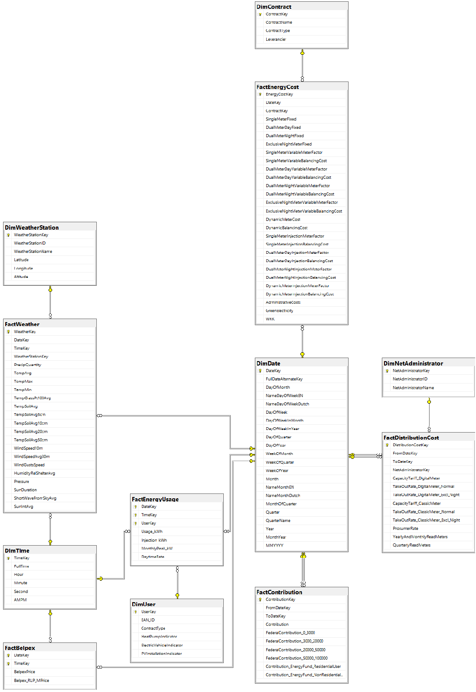

# Smart Meter Data Warehouse

An end-to-end data engineering project that integrates Belgian meter consumption data with electricity tariffs, distribution costs, energy prices and weather data into a centralized SQL Server data warehouse.

The project combines automated data ingestion, ETL pipelines, dimensional data modelling, analytical reporting and machine learning to enable detailed analysis of electricity consumption and costs.

## Architecture



### Data Sources

| Source                 | Data                                 | Ingestion method          |
| ---------------------- | ------------------------------------ | ------------------------- |
| Fluvius Open Data      | Smart meter consumption profiles     | CSV                       |
| Vlaamse Nutsregulator  | Distribution network tariffs         | Web scraping              |
| Mijnenergie.be         | Energy tariffs                       | Web scraping              |
| AWS / Weather stations | Weather station information          | API                       |
| Weather data           | Historical weather observations      | API                       |
| Belpex                 | Belgian day-ahead electricity prices | API                       |
| Other sources          | Contributions and energy costs       | Web scraping / processing |

## Project Structure

```
smartmeter-dwh/
├── analysis/
│   ├── powerbi/smartmeter.pbit
│   ├── 01_sql_pandas_analysis.ipynb
│   └── 02_machine_learning.ipynb
├── data/
|   ├── distribution/
|   ├── input/
│   ├── P6269_1_50_DMK_Sample_Elek
|   └── tarrifs/
├── docs/
│   ├── images/DWH-schema.png
│   ├── reports/
|   |   ├── 01_sql_pandas_analysis.pdf
|   |   ├── 02_machine_learning.pdf
|   |   └── smartmeter.pdf
|   └── openapi.yaml
├── logs/
├── scripts/
|   ├── __init__.py
|   ├── getAwsStations.py
|   ├── getContributionCosts.py
|   ├── getDistributionCosts.py
|   ├── getEnergyCosts.py
|   └── scrapeTarrifCards.py
├── sql/
│   ├── 01_create_dwh.sql
│   ├── 02_procedures.sql
|   └── 03_triggers.sql
├── src/smartmeter/
|   ├── api/
|   |   ├── __init__.py
|   |   └── app.py
|   ├── etl/
|   |   ├── __init__.py
|   |   ├── init_dwh.py
|   |   ├── load_dwh.py
|   |   ├── update_belpex.py
|   |   └── update_weather.py
|   ├── __init__.py
|   ├── config.py
|   └── db.py
├── .dockerignore
├── .env.example
├── .gitignore
├── docker-compose.yml
├── Dockerfile
├── LICENSE
├── pyproject.toml
├── README.md
├── requirements-dev.txt
└── requirements.txt
```

## Data Preparation

Before initializing the data warehouse, download the following datasets and place them in the corresponding directories.

### 1. Smart Meter Consumption Data

Download the sample electricity consumption profiles from Fluvius:

[Fluvius - Verbruiksprofielen digitale elektriciteitsmeters: kwartierwaarden voor een volledig jaar.](https://opendata.fluvius.be/explore/assets/1_50-verbruiksprofielen-dm-elek-kwartierwaarden-voor-een-volledig-jaar/)

Extract the downloaded files into:

```text
data/P6269_1_50_DMK_Sample_Elek/
```

### 2. Distribution Network Tariffs

Download the historical approved distribution network tariffs:

[Vlaamse Nutsregulator - Historiek goedgekeurde distributienettarieven](https://www.vlaamsenutsregulator.be/elektriciteit-en-aardgas/nettarieven/hoeveel-bedragen-de-distributienettarieven/historiek-goedgekeurde-distributienettarieven)

Place the downloaded files in:

```text
data/distribution/
```

## Installation & Setup

The following instructions use PowerShell on Windows.

### 1. Clone the repository

```powershell
git clone https://github.com/Kjellvdb/smartmeter-dwh.git
cd smartmeter-dwh
```

### 2. Create a virtual environment

```powershell
python -m venv .venv
.venv\Scripts\Activate.ps1

python -m pip install --upgrade pip
pip install -r requirements-dev.txt
```

### 3. Configure environment variables

Create your local environment file:

```powershell
Copy-Item .env.example .env
```

Configure the database connection and other required settings in `.env`.

### 4. Start the database

```powershell
docker compose up -d db
```

Build the application container:

```powershell
docker compose build app
```

## Initial Data Warehouse Setup

Run the following commands from the project root.

### 1. Retrieve and prepare source data

```powershell
docker compose run --rm app python scripts/getAwsStations.py
docker compose run --rm app python scripts/getDistributionCosts.py
docker compose run --rm app python scripts/scrapeTarrifCards.py
docker compose run --rm app python scripts/getContributionCosts.py
docker compose run --rm app python scripts/getEnergyCosts.py
```

### 2. Initialize the Data Warehouse

Create the database tables and stored procedures:

```powershell
docker compose run --rm app python -m smartmeter.etl.init_dwh
```

### 3. Load initial data

Load the source data and official RLP-M values:

```powershell
docker compose run --rm app python -m smartmeter.etl.load_dwh
```

### 4. Retrieve external data

Load historical weather observations and Belgian day-ahead electricity prices:

```powershell
docker compose run --rm app python -m smartmeter.etl.update_weather --from 2023-01-01
docker compose run --rm app python -m smartmeter.etl.update_belpex --from 2023-01-01
```

### 5. Initialize SQL triggers

Initialize the triggers responsible for handling provisional monthly values.

```powershell
docker compose run --rm app python -m smartmeter.etl.init_dwh --triggers
```

### 6. Start the API

```powershell
docker compose up -d api
```

## API

The project includes a REST API for accessing data warehouse information.

- **Swagger UI:** [http://localhost:5000/apidocs/](http://localhost:5000/apidocs/)
- **OpenAPI specification:** `docs/openapi.yaml`

The API can be explored and tested through the interactive Swagger interface.

## Analytics & Machine Learning

The `analysis/` directory contains the analytical components of the project.

| File                           | Description                                           |
| ------------------------------ | ----------------------------------------------------- |
| `01_sql_pandas_analysis.ipynb` | SQL queries, data exploration and Pandas analysis     |
| `02_machine_learning.ipynb`    | Machine learning experiments and predictive modelling |
| `powerbi/smartmeter.pbit`      | Power BI dashboard                                    |

The accompanying reports are available in `docs/reports/`.

## Database Access

The SQL Server database can be accessed through SQL Server Management Studio (SSMS).

Use the following connection settings:

| Setting                  | Value                     |
| ------------------------ | ------------------------- |
| Server Name              | `{DB_SERVER},{DB_PORT}`   |
| Authentication           | SQL Server Authentication |
| Login                    | `{DB_USERNAME}`           |
| Password                 | `{DB_PASSWORD}`           |
| Database                 | `{DB_DATABASE}`           |
| Trust server certificate | Enabled                   |

Replace the placeholders with the corresponding values from your `.env` configuration.

## Automated Updates

The project supports scheduled updates for weather observations and Belpex electricity prices.

### Linux – Cron

Add the following entry to your crontab:

```cron
0 6 * * * cd /path/to/smartmeter-dwh && docker compose run --rm app python -m smartmeter.etl.update_weather && docker compose run --rm app python -m smartmeter.etl.update_belpex
```

This executes both update pipelines daily at 06:00.

### Windows – Task Scheduler

On Windows, configure a daily scheduled task using the same two Docker Compose commands.

## Jupyter Notebooks

Start JupyterLab inside the application container:

```powershell
docker compose run --rm -p 8888:8888 app jupyter lab --ip 0.0.0.0 --allow-root
```

## Technologies

| Category         | Technologies                    |
| ---------------- | ------------------------------- |
| Programming      | Python, SQL                     |
| Data Engineering | ETL, Data Warehousing           |
| Database         | Microsoft SQL Server            |
| Data Analysis    | Pandas, NumPy                   |
| Machine Learning | Scikit-learn                    |
| Visualization    | Power BI, Matplotlib            |
| API Development  | Python, REST, Swagger / OpenAPI |
| Automation       | Cron, SQL Triggers              |
| Infrastructure   | Docker, Linux                   |
| Version Control  | Git                             |

## License

This project is licensed under the terms of the [MIT License](LICENSE).
